<p align="center">
  
</p>
<h1 align="center">Steerify</h1>
<p align="center"><b>You decide. Claude builds.</b><br>
A native Mac app for steering <a href="https://claude.com/claude-code">Claude Code</a> across your projects.</p>

<p align="center">
  <a href="https://github.com/thisfiore/steerify-release/releases"></a>
  <a href="LICENSE"></a>
  
  <a href="https://github.com/thisfiore/steerify-release/stargazers"></a>
</p>

<p align="center">
  <a href="https://github.com/thisfiore/steerify-release/releases"><b>Download for Mac</b></a> ·
  <a href="https://steerify.dev">steerify.dev</a> ·
  <a href="https://github.com/thisfiore/steerify-release/issues/new?template=bug.yml">Report a bug</a> ·
  <a href="https://github.com/thisfiore/steerify-release/issues/new?template=feature.yml">Suggest a feature</a>
</p>

<p align="center"></p>

## The problem

Nine Claude sessions open. Fine, nineteen. Okay, ninety-nine. Three of them are waiting on you. Guess which.

<p align="center"></p>

Steerify puts every session on a roadmap item and shows you the ones that need you.

## Deciding is the whole job

Claude never builds on a guess. It asks on the board first, one picture per option, and you answer in seconds:
pick one, blend two with a note, write your own, or park it. Your answers start the build.

<p align="center"></p>

## How it works

<table>
  <tr>
    <td width="50%"><br><b>Build the right thing.</b> Each answer starts a Claude session, already briefed, in the right repo.</td>
    <td width="50%"><br><b>Always in sync.</b> Every session sits on its roadmap item. The status moves on its own.</td>
  </tr>
  <tr>
    <td><br><b>Only what needs you.</b> Many sessions running, a few waiting on you. You see those.</td>
    <td><br><b>One standard.</b> Finished work arrives as pictures, checked against the same design and tests. Pin a note where it is wrong.</td>
  </tr>
</table>

And this is the real app, on the demo project that comes with it:

<p align="center">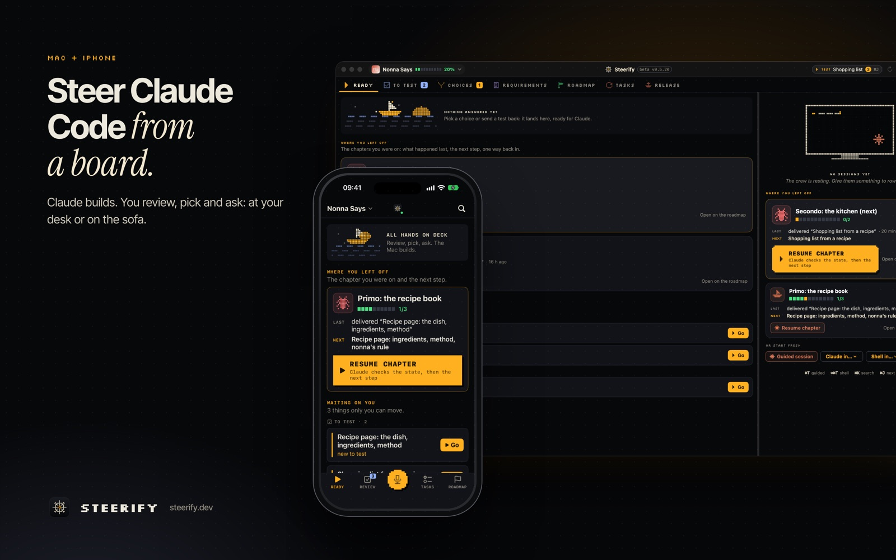<br><b>Mac + iPhone.</b> The same board on both. Claude builds on the Mac; you review, pick and ask from anywhere.</p>

<p align="center">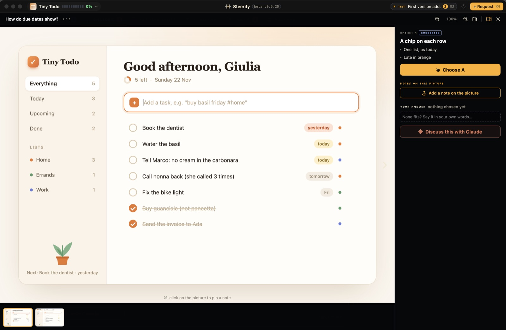<br><b>Decide.</b> A choice, full screen. The option is a picture; one button chooses it.</p>

<table>
  <tr>
    <td width="50%">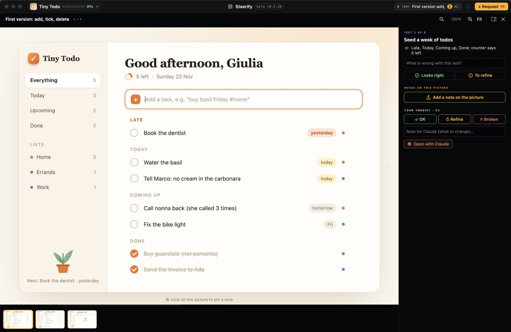<br><b>Look.</b> One test, one picture. Mark it right, then OK, Refine or Broken.</td>
    <td width="50%">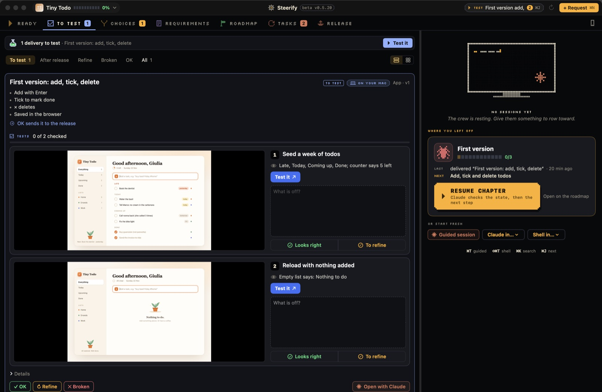<br><b>To test.</b> Every delivery with its tests, a picture for each one.</td>
  </tr>
  <tr>
    <td width="50%">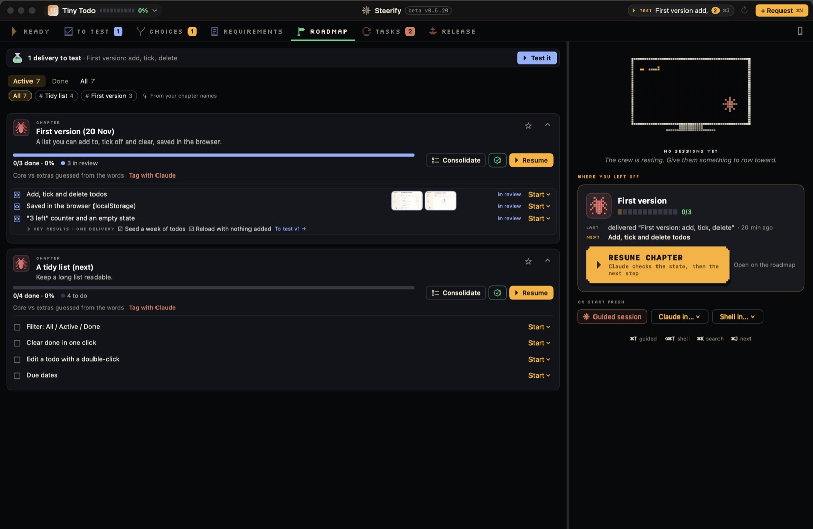<br><b>Roadmap.</b> Chapters, feature chips, pictures on each item, a Start on every line. Star up to 3 chapters to keep them in focus.</td>
    <td width="50%">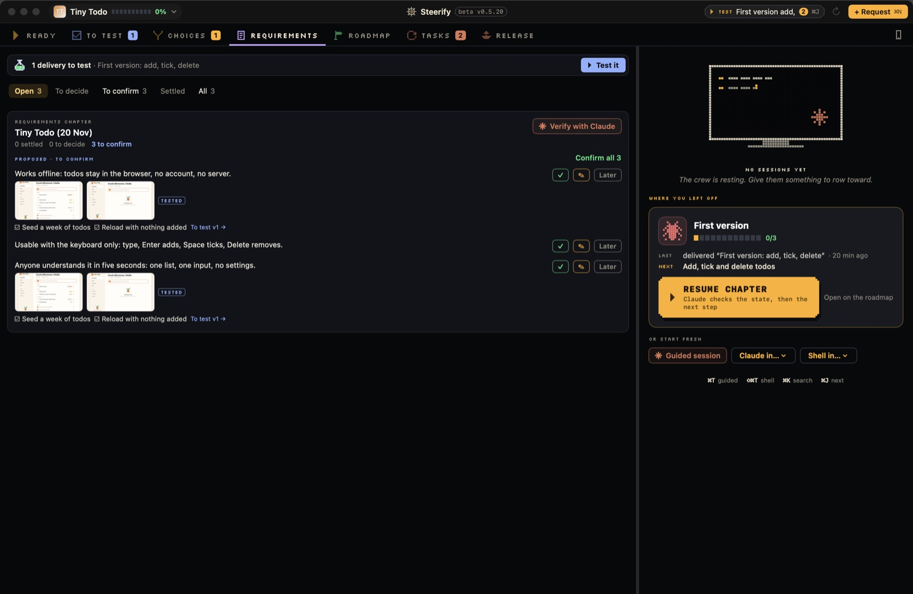<br><b>Requirements.</b> Claude proposes them. You confirm, edit or park each line.</td>
  </tr>
  <tr>
    <td width="50%">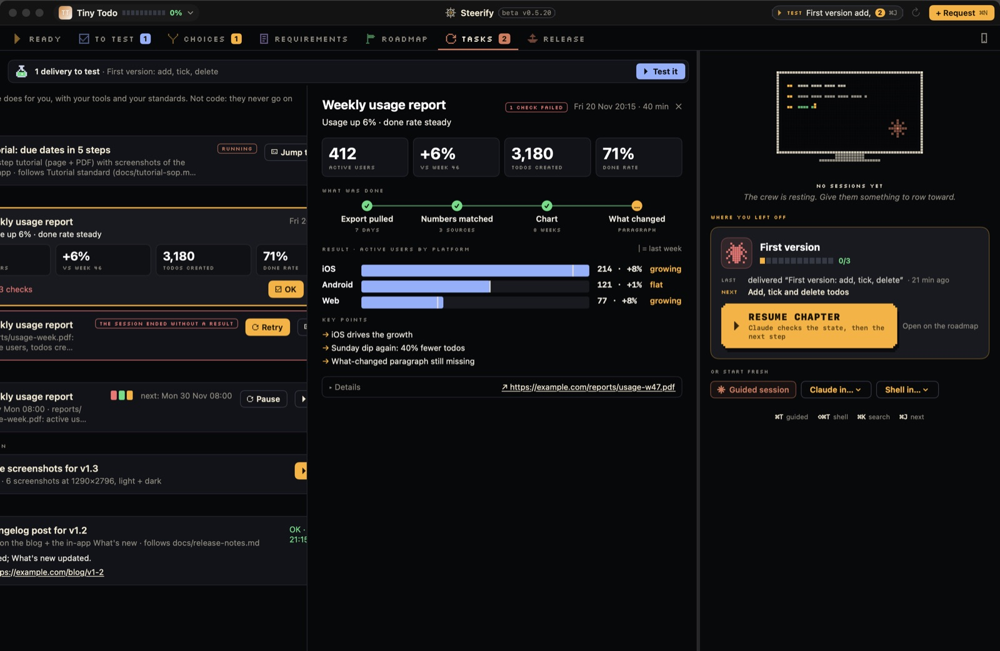<br><b>Tasks.</b> Work that isn't code (a tutorial, a weekly report), once or on a schedule. Every run ends with a result you OK or send back.</td>
    <td width="50%">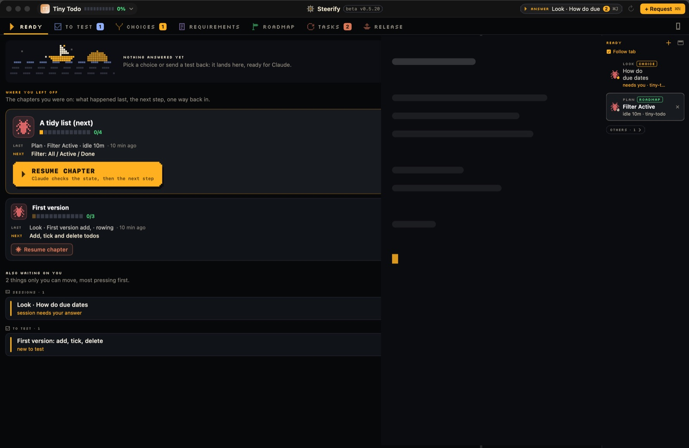<br><b>Sessions.</b> Each session on its item, whose turn it is at a glance. Ready shows where you left off.</td>
  </tr>
  <tr>
    <td width="50%">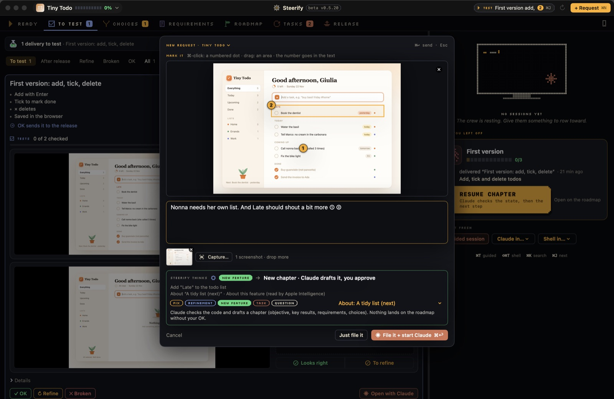<br><b>Request.</b> Mark the picture, say what's wrong. Steerify files it as a fix, a feature or a task.</td>
    <td width="50%">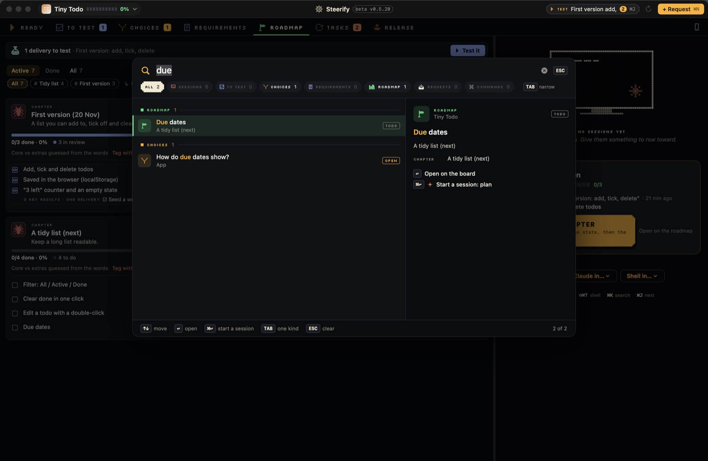<br><b>Search.</b> One search across sessions, choices, roadmap and requests.</td>
  </tr>
  <tr>
    <td width="50%">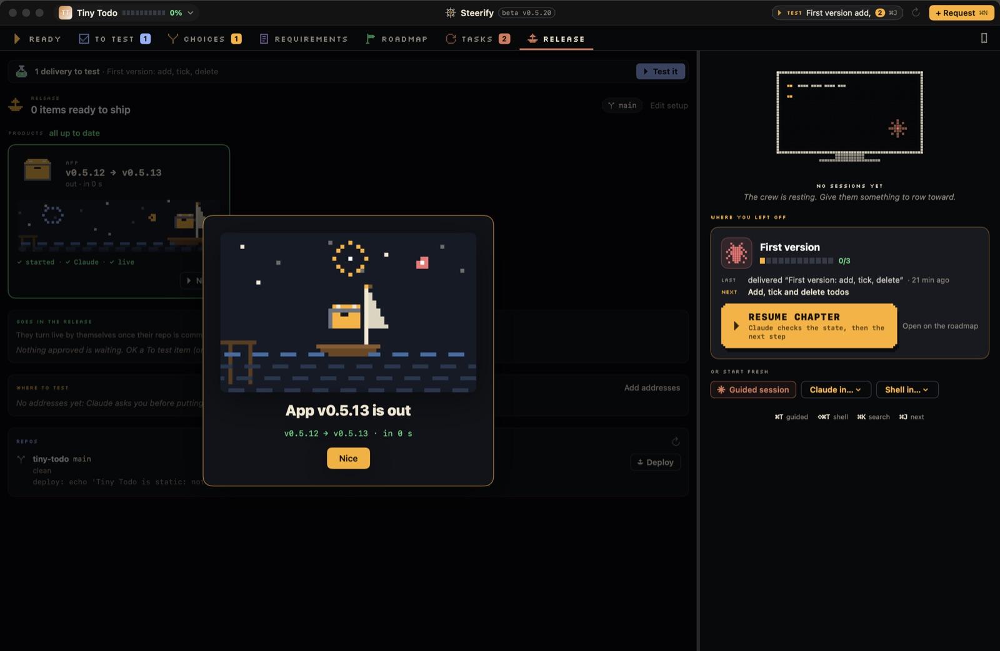<br><b>Ship.</b> Release by product: the Mac app, the site, the iPhone. One button each; fireworks when it's out.</td>
    <td width="50%">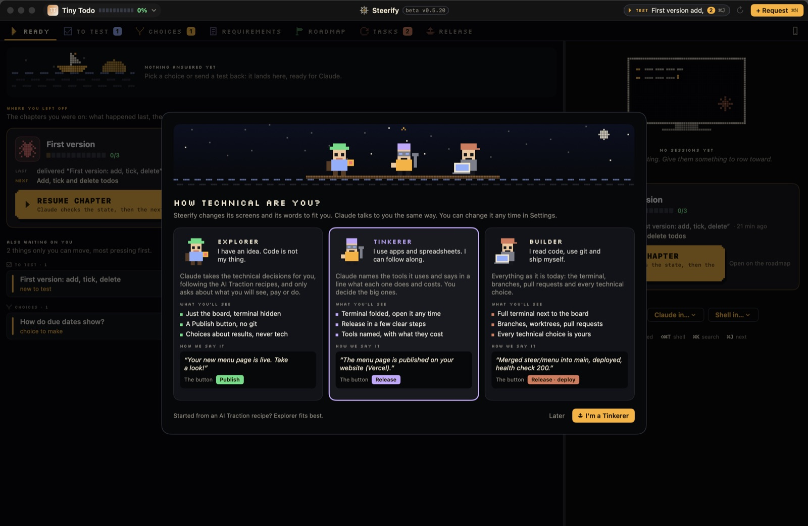<br><b>Your level.</b> Explorer, Tinkerer or Builder. Steerify and Claude talk to you the way you work.</td>
  </tr>
</table>

On your iPhone (private beta): say a request out loud, Steerify files it.

<p align="center">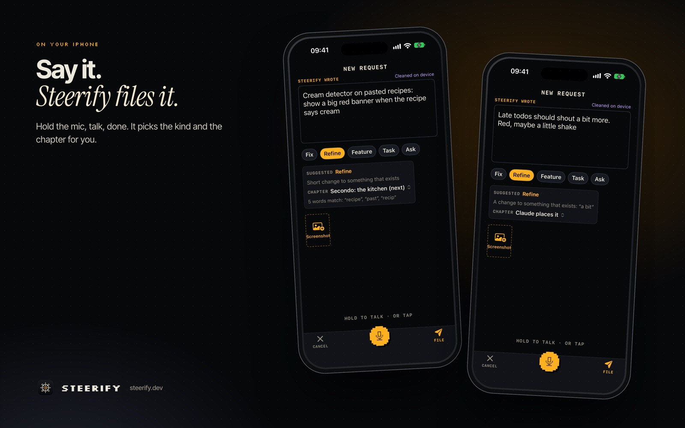</p>

## Install

1. [Download the latest build](https://github.com/thisfiore/steerify-release/releases), open the DMG and drag Steerify to Applications.
2. Open it and add a project: pick any folder. Steerify creates a `.steerify/` board inside it.
3. Start an item. It opens a Claude Code session in the right repo, already briefed.
4. That's it for updates: Steerify downloads new versions by itself. Click the green **Update** next to the logo, or just quit.
   Click the version badge to see what's new.

Or with Homebrew:

```sh
brew tap thisfiore/steerify https://github.com/thisfiore/steerify-release
brew trust thisfiore/steerify   # Homebrew 7+ asks you to trust third-party taps
brew install --cask steerify
```

You need macOS 15 or later and [Claude Code](https://claude.com/claude-code) with your own login. Mac only.

Early builds are not notarized by Apple yet: the first time, open the app from System Settings → Privacy & Security → Open Anyway.

## Under the hood

- **Native.** SwiftUI and [SwiftTerm](https://github.com/migueldeicaza/SwiftTerm) terminals. No Electron.
- **Your board lives in your repo.** Plain JSON files in a workspace folder, described in [`docs/FORMAT.md`](docs/FORMAT.md). Delete Steerify and it is all still yours.
- **A Claude Code skill does the talking.** Steerify installs [`skills/steerify`](skills/steerify/SKILL.md), the loop every session follows: read the item, ask choices on the board, deliver to To test, read verdicts, release.
- **Three ways to use git,** per project: on main, a worktree per feature, or a branch with a pull request that your OK merges.
- **Release by product.** One card per thing you ship (Mac app, website, iPhone app) with its live version. Ship one: it shows shipping, then live.
- **Your dev servers, under the sessions.** Processes from `steerify.json` sit under the session list: start, stop, restart, read the logs.
- **The small jobs stay on your Mac.** Session summaries, request sorting and screenshot checks use Apple Intelligence on-device, when it is turned on. Claude Code still does the building.

<p align="center"></p>

## Build from source

```sh
scripts/bundle.sh          # → build/Steerify.app
open build/Steerify.app
```

The landing page ([steerify.dev](https://steerify.dev)) is in `site/`. The pictures in this README are rendered from it with `node scripts/readme-art.mjs`.

## Feedback

Found a bug or want something? In the app: the **Beta** pill or the Help menu → Report a bug / Ask for a feature (it shows what is sent, and you see it move to fixed). Or [open an issue](https://github.com/thisfiore/steerify-release/issues/new/choose): there is a short form for each. To contribute code, read [CONTRIBUTING.md](CONTRIBUTING.md).

## License and name

Code is [MIT](LICENSE). The Steerify name and logo are not covered by that license — see [TRADEMARK.md](TRADEMARK.md).

Independent project, not affiliated with Anthropic or Apple. Claude is a trademark of Anthropic; Apple Intelligence is a trademark of Apple.
